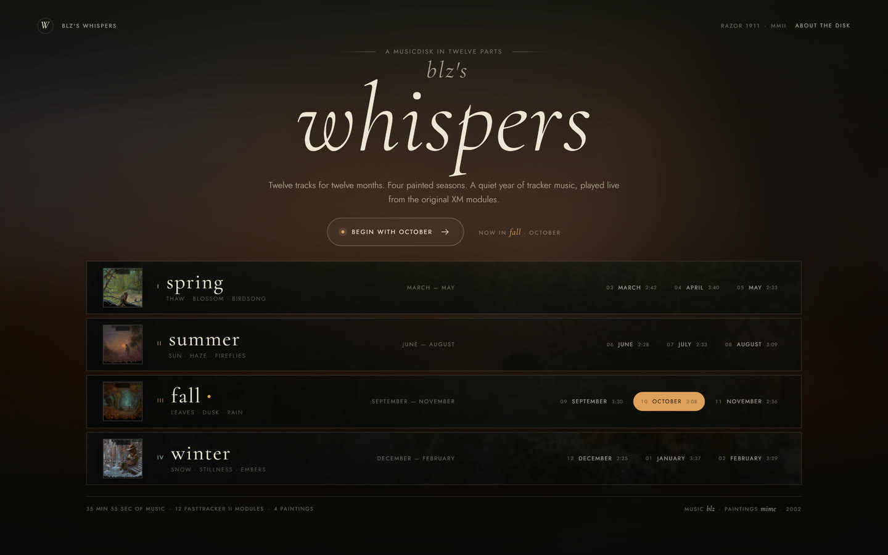
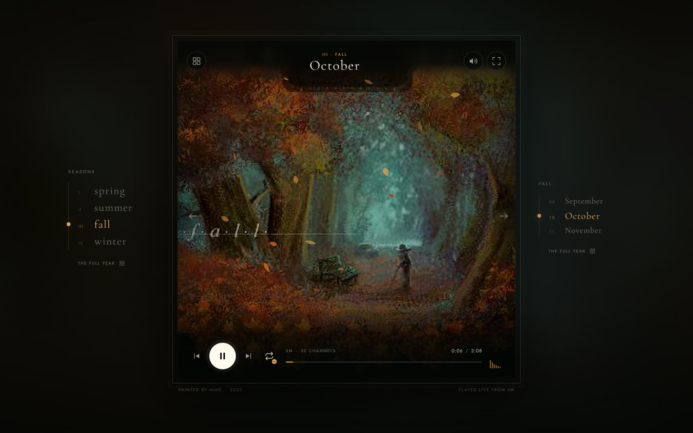
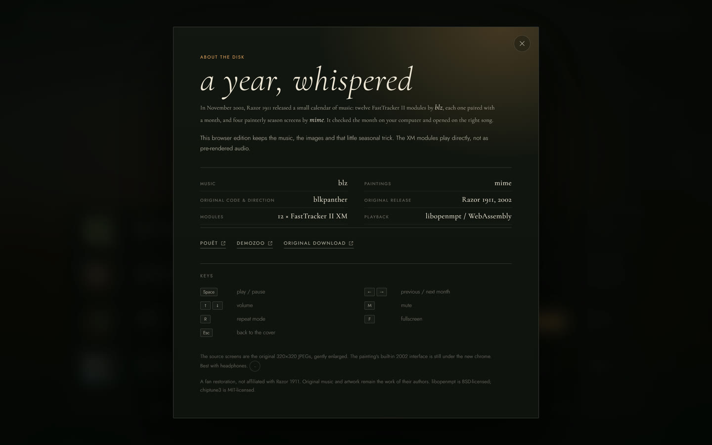
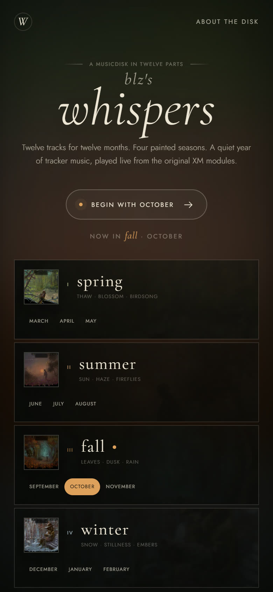
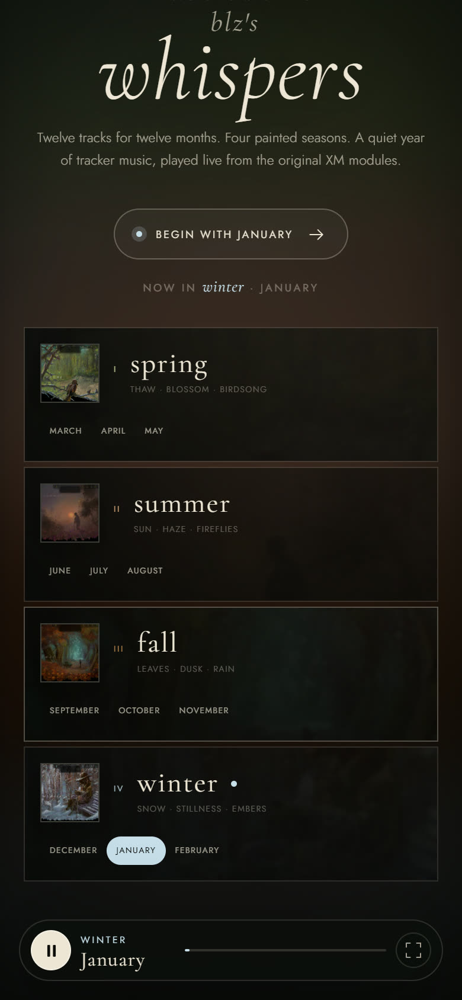

<div align="center">

# blz's whispers

**Twelve tracker modules for twelve months. Four painted seasons. One quiet year — played live in the browser.**

<sub>Live site: <a href="https://paracells.github.io/blz-whispers/">paracells.github.io/blz-whispers</a> — the same build as this repository</sub>

<a href="docs/screenshots/cover.jpg"></a>

</div>

---

## What this is

In November 2002 the PC group **Razor 1911** released *blz's whispers*, a small calendar of a musicdisk: twelve FastTracker II modules by **blz**, one for each month, wrapped in four painterly season screens by **mime**. It read the month from your computer and opened on the right song.

This is an unofficial browser restoration of that idea. The original `.xm` files are played **live** — decoded by libopenmpt compiled to WebAssembly, inside an AudioWorklet — so nothing here is a pre-rendered MP3 and no audio is streamed from a third party. The paintings, the names of the months and the seasonal trick are all kept: the page starts on the month your computer thinks it is.

## Highlights

- **Real module playback** — all twelve original XM modules, rendered in the browser by libopenmpt through the Web Audio API.
- **The whole year at a glance** — a calendar cover with four season rows, the twelve months, durations and channel counts.
- **The paintings** — mime's 2002 season screens, enlarged from the original 320×320 JPEGs to 1280×1280 and presented as a framed page.
- **Calendar navigation** — month chips, season rails, page arrows, deep links such as `#/winter/january`, and working browser history.
- **Repeat modes** — all months (`∞`), one month (`1`), or off (`–`). With "all months", the end of a track turns the page to the next month.
- **A proper little player** — seekable progress bar, volume that is remembered, mute, live level meter, fullscreen, and a mini player that stays on the cover while the music continues.
- **Seasonal atmosphere** — canvas petals, fireflies, falling leaves and snow, all switched off when the operating system asks for reduced motion.
- **Responsive from phone to desktop** — the calendar fits one screen on laptops, the seasons stack into single columns on phones.

## Screenshots

| The player — autumn | About the disk |
| --- | --- |
| <a href="docs/screenshots/player.jpg"></a> | <a href="docs/screenshots/about.jpg"></a> |

| On a phone | …with the mini player |
| --- | --- |
| <a href="docs/screenshots/mobile-cover.jpg"></a> | <a href="docs/screenshots/mobile-mini.jpg"></a> |

## Run it locally

The page must be served over HTTP. Opening `index.html` straight from disk with `file://` will not work, because browsers block AudioWorklet modules and `fetch()` of the XM files from local files.

**Windows** — double-click **`start.bat`**. It starts the included server and opens your browser. If Node.js is missing it falls back to Python's built-in web server; if port 8080 is busy, `serve.js` moves on to the next free port and tells you which one.

**Any system with Node.js**

```sh
node serve.js                 # http://localhost:8080/
node serve.js --port 9000     # another port
node serve.js --no-open       # don't open a browser
```

**Any system with Python 3**

```sh
python -m http.server 8080 --bind 127.0.0.1
```

## Controls

| Action | Control |
| --- | --- |
| Play / pause | `Space`, or the round transport button |
| Previous / next month | `←` / `→`, page arrows, or transport buttons |
| Volume | `↑` / `↓`, or the speaker button |
| Mute | `M` |
| Repeat mode: all months / one month / off | `R`, or the repeat button |
| Fullscreen | `F`, or the top-right fullscreen button |
| Return to the cover | `Esc`, or the grid button |

### Repeat modes

- **∞ all months** — the calendar advances to the next month when a track ends.
- **1 one month** — the current module starts again.
- **– off** — playback stops at the end of the module.

### Direct links

Every month has its own route, so a track can be bookmarked or shared:

```text
#/winter/january
#/spring/april
#/summer/july
#/fall/october
```

A season-only route such as `#/fall` opens the current month if it belongs to that season, otherwise the first month of the season. Browser back and forward move between the cover and the player.

Volume is stored in `localStorage`. Layout, particles and transitions respect `prefers-reduced-motion`.

## How the audio works

1. `js/app.js` fetches the month's `.xm` file, once, and caches it in memory; the other eleven are prefetched while the browser is idle.
2. The bytes are handed to a vendored and patched copy of [chiptune3](https://github.com/DrSnuggles/chiptune), whose AudioWorklet decodes them with libopenmpt and renders the PCM stream.
3. The worklet's output runs through an `AnalyserNode` before the destination, which is what drives the small level meter without touching the audible mix.

Two small patches to the vendored worklet matter here: progress messages are throttled to roughly twelve per second, and temporary buffers are released when a module is created or stopped, so switching months for an hour does not leak memory. Amiga A1200 resampler emulation was dropped in favour of libopenmpt's normal PC resampling.

One deliberate player choice: in "all months" mode the end of a track advances the calendar instead of looping the module inside libopenmpt. That keeps the calendar metaphor intact.

## Project structure

```text
index.html                  interface markup, icon sprite and about dialog
css/style.css               the visual system, breakpoints and season palettes
js/app.js                   playback, routing, transport, volume, UI state
js/tracks.js                the calendar: seasons, months, durations, metadata
js/particles.js             canvas petals, fireflies, leaves and snow
assets/art/                 the four season paintings and the cover (upscaled 320×320 originals)
assets/fonts/               locally hosted Cormorant Garamond and Jost
assets/music/               the twelve original XM modules
vendor/chiptune3.js         small WebAudio wrapper
vendor/chiptune3.worklet.js AudioWorklet and libopenmpt bridge (patched)
vendor/libopenmpt.worklet.js embedded libopenmpt WebAssembly
docs/screenshots/           the images used in this README
.github/workflows/deploy.yml GitHub Pages deployment
serve.js                    zero-dependency local static server
start.bat                   Windows launcher with a Node → Python fallback
```

The original `.xm` and `.jpeg` files from the scene.org download are kept at the top level, untouched, next to the lowercase copies the app loads. The four season images and the cover were enlarged with Lanczos resampling and a light unsharp pass; no painting detail was redrawn.

## Publishing with GitHub Pages

The site runs at **<https://paracells.github.io/blz-whispers/>**. GitHub Pages serves it over HTTPS, which is what AudioWorklet needs, and every path in the app is relative, so the project also works from the `/blz-whispers/` subdirectory.

There is no build step and no branch to maintain: `.github/workflows/deploy.yml` republishes the site on every push to `main`.

```sh
git add -A
git commit -m "what changed"
git push
```

To publish your own copy instead:

1. Create an empty public repository called **`blz-whispers`** on GitHub.
2. Push this folder's `main` branch to it.
3. Open the repository → **Settings → Pages** → **Source** → **GitHub Actions**.
4. Optional: **Settings → General → Social preview** → upload `docs/screenshots/social-preview.jpg`.

If the first run fails with *“Get Pages site failed”*, Pages has not been switched to GitHub Actions yet — that **Source** setting is a one-time toggle and the workflow cannot flip it for you.

A custom domain can be added under **Settings → Pages → Custom domain**; no code changes are needed.

## Credits and provenance

- **Music:** blz
- **Paintings:** mime
- **Original code and direction:** blkpanther
- **Original release:** Razor 1911, 2002
- **Production page:** <https://www.pouet.net/prod.php?which=7989>
- **Demozoo entry:** <https://demozoo.org/productions/8245/>
- **Original download:** <https://files.scene.org/view/music/disks/rzr-whispers.zip>

This is a fan restoration, not affiliated with Razor 1911. The music and paintings remain the work of their authors; the browser interface, code and local presentation are a new wrapper around those originals.

The code of this browser edition is [MIT licensed](LICENSE). Music, paintings and original demo material are **not** covered by that licence. libopenmpt (BSD-3-Clause), chiptune3 (MIT) and the two fonts (SIL Open Font License) keep their own terms, listed in [THIRD_PARTY.md](THIRD_PARTY.md).

## Browser notes

- A current Chrome, Edge, Firefox or Safari is recommended.
- AudioWorklet requires a secure context; `localhost`, `127.0.0.1` and GitHub Pages all qualify, `file://` does not.
- The first play click starts the WebAssembly engine and may take a moment while the 1.5 MB worklet is prepared; after the first interaction the engine is warmed in the background.
- On phones the audio starts on the first tap of the play button, as mobile browsers require.
- Once the page is open, no network connection is needed: the modules, paintings, fonts and the player itself are all local to the site.
